# 🎬 Awesome Video Editing &amp; Clipper Automation 🚀

  
  
  
  
  
  

**A curated index of top-tier SaaS platforms, cloud clipper tools, and open-source libraries for AI video editing, automated long-to-short repurposing, active-speaker auto-reframing, Whisper word-level subtitles, and programmatic media workflows.**

🌟 *Star this repository to bookmark the latest tools in video clipper automation!* 🌟

---

## 📑 Table of Contents
- [🌐 Sector Overview & Market Dynamics](#-sector-overview--market-dynamics)
- [💼 SaaS & Cloud Hosted Platforms](#-saas--cloud-hosted-platforms)
- [💻 Open-Source GitHub Projects](#-open-source-github-projects)
- [🤝 How to Contribute](#-how-to-contribute)
- [💖 Support](#-support)
- [📈 Star History](#-star-history)
- [📜 Disclaimer](#-disclaimer)

---

## 🌐 Sector Overview & Market Dynamics

The global video editing and automated content repurposing software market is projected to grow from **$3.6 billion in 2024 to over $7.1 billion by 2030 (CAGR ~12.3%)**, propelled by the exponential rise of vertical short-form algorithms across TikTok, YouTube Shorts, and Instagram Reels. 

The industry exhibits a **moderately fragmented landscape with dual-tier specialization**: massive enterprise incumbents (such as Adobe and Microsoft) dominate full-suite multi-track timelines and cloud ecosystems, while agile specialized AI startups (like OpusClip, Descript, Riverside.fm, and VEED.IO) capture fast viral growth in single-purpose automation layers such as active-speaker reframing (16:9 to 9:16), acoustic silence removal, and animated Whisper karaoke captions. Concurrently, a vibrant open-source ecosystem (FFmpeg, yt-dlp, Remotion, LosslessCut, VideoLingo) provides developers with modular building blocks to run private, cost-free video clipping pipelines locally.

---

## 💼 SaaS & Cloud Hosted Platforms

*Below is a comprehensive comparison of leading video editing and clipper automation SaaS platforms, sorted in descending order by enterprise valuation / market capitalization.*

| 🏷️ Product | 🏢 Company Scale (Valuation / Market Cap / Revenue) | 💵 Starting Tier Price | 🎁 Free Tier Limit / Free Trial Plan | 🔍 Key Automation Features |
| :--- | :--- | :--- | :--- | :--- |
| **[Adobe Premiere Pro & Express](https://adobe.com)** | **$215B+** (Public: NASDAQ: ADBE; ~$21.4B Annual Revenue) | **$9.99/mo** (Express Premium) or **$22.99/mo** (Premiere Pro standalone) | **Free Forever Plan:** 25 generative AI credits/mo, basic video editing & quick social exports (Premiere Pro offers a 7-day fully functional free trial) | AI Auto Reframe (16:9 to 9:16), speech-to-text text-based transcript editing, auto audio ducking, and direct social channel publishing. |
| **[Microsoft Clipchamp](https://clipchamp.com)** | **$3.1T+** (Parent: Microsoft Corp; NASDAQ: MSFT) | **$11.99/mo** (Clipchamp Premium plan) | **Free Forever Plan:** Unlimited 1080p watermark-free exports, auto-captions generator, and stock audio/video filters | Automatic silence removal, speech-to-text subtitling, social aspect-ratio presets (9:16, 1:1, 16:9), and cloud OneDrive integration. |
| **[Runway Video Editor](https://runwayml.com)** | **~$4.0B** valuation ($141M+ venture funding raised) | **$15/user/mo** ($12/mo billed annually - Standard tier) | **Free Forever Plan:** 125 one-time video generation credits, 3 video projects, 720p video exports | Generative AI timeline editing, magic green screen rotoscoping, object motion brush, text-to-video, and instant background removal. |
| **[Descript](https://descript.com)** | **~$550M** valuation (Backed by OpenAI Startup Fund, Andreessen Horowitz) | **$19/user/mo** ($12/mo billed annually - Hobbyist tier) | **Free Forever Plan:** 1 transcription hour/mo, 1 watermark-free 720p video export/mo, 60 min of Studio Sound audio cleanup | Text-based video editing, AI highlight clipping ("Underlord"), filler-word removal ("uh/um"), automatic eye contact correction, and dynamic caption styles. |
| **[Kapwing](https://kapwing.com)** | **~$250M** valuation ($11M Series A led by CRV, Kleiner Perkins) | **$24/user/mo** ($16/mo billed annually - Pro tier) | **Free Forever Plan:** 3 watermark-free video exports/mo (up to 7 min length, 720p resolution), 10 min of auto-subtitles/mo | Smart Cut silence trimmer, AI Repurpose Studio, automatic 16:9 to 9:16 subject reframing, and team cloud collaboration timeline. |
| **[VEED.IO](https://veed.io)** | **~$150M** valuation (~$25M+ Annual Recurring Revenue bootstrapped) | **$18/user/mo** ($12/mo billed annually - Lite tier) | **Free Forever Plan:** Unlimited exports with VEED watermark (up to 10 min length, 720p quality), 30 min of auto-subtitles/mo | AI Magic Cut & Auto-Clipper, animated karaoke word captions, eye-contact tracking, voice dubbing, and screen recording studio. |
| **[Riverside.fm](https://riverside.fm)** | **~$100M** valuation ($47M total raised, Series B led by Alexis Ohanian) | **$19/mo** ($15/mo billed annually - Standard tier) | **Free Forever Plan:** 2 hours of separate audio/video recording tracks, unlimited 720p exports with watermark, and free access to test Magic Clips | Magic Clips AI highlight generator, active-speaker vertical cropping, 4K studio recording, and automatic word-by-word transcription. |
| **[InVideo AI](https://invideo.io)** | **~$60M** valuation ($52M+ funding raised) | **$25/mo** ($20/mo billed annually - Plus tier) | **Free Forever Plan:** 10 min/week of AI generation credits with InVideo watermark, 4 exports/week, and 10GB cloud storage | Text-to-video prompt workflow, automated scriptwriting, social media voiceover synchronization, and prompt-driven video trimming. |
| **[OpusClip](https://opus.pro)** | **~$40M** valuation (Backed by DCM Ventures, high-growth AI clipper) | **$15/mo** ($9/mo billed annually - Starter tier) | **Free Forever Plan:** 60 free minutes/mo of AI clipping with watermark; or 7-day Pro free trial with 90 watermarked credits | Virality Score algorithm, AI B-roll generation, active-speaker auto-centering, emoji subtitles, and multi-platform schedule auto-posting. |
| **[WeVideo](https://wevideo.com)** | **~$35M** valuation (~$10M+ Annual Recurring Revenue) | **$9.99/mo** ($4.99/mo billed annually - Power tier) | **Free Forever Plan:** 5 min/mo of published video time with 480p resolution and WeVideo watermark, 1GB cloud storage | Multi-track timeline, cloud asset library, green-screen chroma key, motion titles, and classroom/enterprise collaborative workflows. |
| **[FlexClip](https://flexclip.com)** | **~$15M** valuation (~$5M+ Annual Recurring Revenue - PearlMountain) | **$19.99/mo** ($9.99/mo billed annually - Plus tier) | **Free Forever Plan:** 12 video projects, 1 stock video/audio per project, 720p watermarked video downloads (up to 10 min duration) | AI text-to-video generator, AI subtitle creator, background remover, social short-form templates, and cloud video compressor. |

---

## 💻 Open-Source GitHub Projects

*Curated collection of premier open-source video editing tools, programmatic clip generators, silence trimmers, and subtitle engines — sorted in descending order by GitHub Stars.*

1. **[yt-dlp/yt-dlp](https://github.com/yt-dlp/yt-dlp)**   
   ⚡ Essential command-line media extraction utility with built-in `--download-sections` timestamp cropping, SponsorBlock highlight parsing, and multi-format container packaging for raw footage sourcing.

2. **[harry0703/MoneyPrinterTurbo](https://github.com/harry0703/MoneyPrinterTurbo)**   
   🤖 Full-pipeline automated AI short-form video generator that synthesizes viral video scripts, orchestrates vertical 9:16 layout assembly, generates TTS voiceovers, and auto-burns dynamic animated captions.

3. **[OpenCut-app/OpenCut](https://github.com/OpenCut-app/OpenCut)**   
   ✂️ Free, open-source privacy-centric CapCut alternative for web and desktop built for modern social media creators and rapid timeline trimming.

4. **[remotion-dev/remotion](https://github.com/remotion-dev/remotion)**   
   ⚛️ Industry-standard programmatic video creation framework enabling developers to build dynamic video templates, automated social clip engines, and animated subtitle tickers using React and TypeScript.

5. **[FFmpeg/FFmpeg](https://github.com/FFmpeg/FFmpeg)**   
   🎞️ The universal multimedia engine powering hardware-accelerated video rendering, audio stream multiplexing, complex filtergraphs, auto-crop detection, and subtitle burn-in.

6. **[mifi/lossless-cut](https://github.com/mifi/lossless-cut)**   
   🚀 Blazing-fast cross-platform GUI for instant zero-reencode video trimming, keyframe-accurate segment extraction, and batch highlight clipping powered by FFmpeg.

7. **[m-bain/whisperX](https://github.com/m-bain/whisperX)**   
   🎙️ Advanced Automatic Speech Recognition (ASR) framework with phoneme-level forced alignment timestamps and PyAnnote speaker diarization — powering frame-accurate highlight cutting and kinetic karaoke subtitles.

8. **[Huanshere/VideoLingo](https://github.com/Huanshere/VideoLingo)**   
   🌐 All-in-one AI video repurposing system providing Netflix-grade subtitle segmentation, LLM translation, natural voice cloning, and auto-dubbing with personalized voice timbre matching.

9. **[mltframework/shotcut](https://github.com/mltframework/shotcut)**   
   🎥 Cross-platform non-linear video editor featuring automated speech-to-text subtitles, multi-format 4K timelines, GPU acceleration, and social vertical export presets.

10. **[Zulko/moviepy](https://github.com/Zulko/moviepy)**   
    🐍 Popular Python library for automated non-linear video editing, dynamic clip concatenation, GIF generation, title compositing, and custom visual effects.

11. **[SubtitleEdit/subtitleedit](https://github.com/SubtitleEdit/subtitleedit)**   
    📝 Powerful open-source subtitle editor with audio waveform visualizers, automated speech recognition sync, and rich ASS/SRT caption styling for vertical shorts.

12. **[kkroening/ffmpeg-python](https://github.com/kkroening/ffmpeg-python)**   
    🔧 Idiomatic Python bindings for FFmpeg with fluent complex filtergraph composition for building automated clipping and reframing backends.

13. **[RayVentura/ShortGPT](https://github.com/RayVentura/ShortGPT)**   
    🔥 Experimental AI automation framework for YouTube Shorts and TikTok content generation, multi-language asset sourcing, voiceover synthesis, and caption layout.

14. **[Anil-matcha/AI-Youtube-Shorts-Generator](https://github.com/Anil-matcha/AI-Youtube-Shorts-Generator)**   
    🎯 Open-source alternative to OpusClip and Klap that converts long-form YouTube videos into vertical 9:16 viral shorts via Whisper transcript analysis and face-tracking auto-crop without watermarks.

15. **[KDE/kdenlive](https://github.com/KDE/kdenlive)**   
    🎬 Feature-rich open-source non-linear editing suite with integrated Whisper speech-to-text timeline cuts, 9:16 vertical project settings, and motion tracking filters.

16. **[WyattBlue/auto-editor](https://github.com/WyattBlue/auto-editor)**   
    ⚡ High-speed command-line engine that automatically strips dead silences and pauses from audio/video files, with direct timeline export to Premiere Pro, DaVinci Resolve, and Final Cut Pro.

17. **[mifi/editly](https://github.com/mifi/editly)**   
    📦 Declarative command-line and Node.js video editing framework for programmatic video assembly, transitions, audio tracks, and animated graphics.

18. **[Breakthrough/PySceneDetect](https://github.com/Breakthrough/PySceneDetect)**   
    🔍 OpenCV-powered scene cut detector and video segmentation tool that splits long-form recordings into clean chapters and clips using lossless FFmpeg stream copy.

19. **[antiboredom/videogrep](https://github.com/antiboredom/videogrep)**   
    🔎 Python CLI that searches video subtitle files to automatically assemble supercut montages based on matching keywords and linguistic patterns.

20. **[carykh/jumpcutter](https://github.com/carykh/jumpcutter)**   
    ⏩ Groundbreaking automated Python video editor that detects silent audio sections and speeds them up dramatically to create ultra-dense jumpcut content.

21. **[jhj0517/Whisper-WebUI](https://github.com/jhj0517/Whisper-WebUI)**   
    🎧 Web UI interface for multiple OpenAI Whisper implementations, supporting automated subtitle extraction, translation, and SRT/VTT file production.

22. **[absadiki/subsai](https://github.com/absadiki/subsai)**   
    💬 Open-source Python CLI and Web UI wrapping OpenAI Whisper and diverse ASR engines for automated multi-format video subtitling.

23. **[omni-media/omniclip](https://github.com/omni-media/omniclip)**   
    🌐 Modern in-browser video editor running client-side with WebCodecs, WebGL, and WebAssembly FFmpeg without cloud uploads.

24. **[ClipsAI/clipsai](https://github.com/ClipsAI/clipsai)**   
    🧠 Open-source Python library designed to automatically transform long videos into short viral vertical clips using WhisperX and active-speaker face detection.

25. **[NaufalRizqullah/opensource-clipping](https://github.com/NaufalRizqullah/opensource-clipping)**   
    ✨ AI auto-clipper transforming podcasts into viral shorts with smart face-tracking, kinetic karaoke subtitles, contextual B-roll, and auto-upload workflows.

26. **[carlthome/python-audio-effects](https://github.com/carlthome/python-audio-effects)**   
    🎛️ Digital signal processing library to apply audio enhancements, normalization, and EQ directly to video sound tracks.

27. **[WeftCut/WeftCut](https://github.com/WeftCut/WeftCut)**   
    🤖 Cross-platform AI video editor for macOS, Windows, and Linux that allows users to drive timeline actions programmatically from any Model Context Protocol (MCP) client.

---

## 🤝 How to Contribute

We welcome contributions from creators, developers, and founders! To add or update an entry:

1. 🍴 **Fork** the repository.
2. 🌿 **Create a new branch** (`git checkout -b add-my-tool`).
3. 📝 **Add your tool** to the appropriate section:
   - For SaaS platforms: follow the table schema with verified pricing tiers, exact free tier / trial terms, and company scale metrics.
   - For Open-Source projects: provide the exact GitHub repository path with a verified star badge linking to its `/stargazers` page.
4. 🚀 **Commit your changes** (`git commit -m 'feat: Add [Tool Name]'`).
5. 📬 **Open a Pull Request** with a brief summary of why the tool belongs in this curated collection.

---

## 💖 Support

If you find this curated collection useful for your video creation, content repurposing, or automated development pipelines:

- ⭐ **Star this repository** to help others discover it!
- 🍴 **Fork and share** with fellow developers and creators on social channels.
- ☕ **Buy me a coffee / Sponsor**: If you'd like to support ongoing maintenance and curation of open-source resources, please visit the **[GitHub Sponsors Dashboard](https://github.com/sponsors/ishandutta2007)**!

---

## 📈 Star History

---

## 📜 Disclaimer

*This list is curated for informational, educational, and workflow automation purposes. All brand names, logos, trademarks, and registered trademarks belong to their respective owners. Product pricing and terms are subject to change by their respective providers.*
